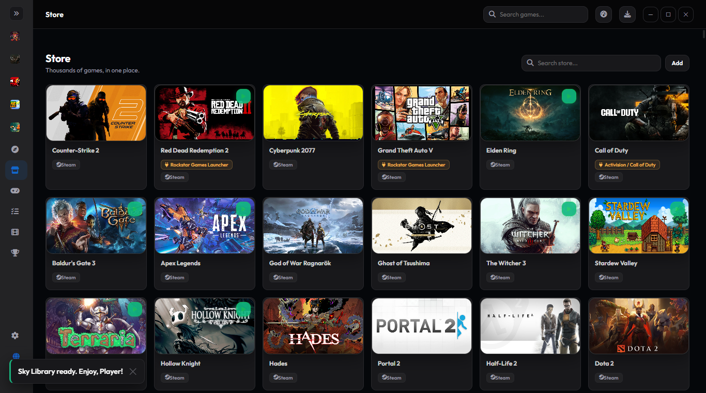

# Sky Library

Steam oyun kütüphanesi için hazırlanmış masaüstü uygulaması. Oyunlar, mağaza, film/dizi oynatıcı, profil, Steam Atölyesi, Online Fix ve dahili hız testi tek bir yerde.

## İndirme

**En son sürüm (v1.5.2):** https://github.com/W3real/Sky-Library-App/releases/latest

Releases sayfasındaki `Sky.Librar.exe` dosyasını indir. (GitHub dosya boyutu sınırı nedeniyle kurulum dosyası repoda değil, Release içinde tutulur.)

Alternatif olarak PowerShell ile son sürümü indirebilirsin:

```powershell
./download.ps1
```

## Kurulum

1. Setup dosyasını indir.
2. Çift tıkla ve kurulum sihirbazını tamamla. Dil seçimi ve kurulum klasörü sorulur.
3. Masaüstündeki **Sky Library** kısayoluyla aç.

Kaldırmak için: Başlat menüsündeki **Sky Library Uninstall** kısayolu veya Windows Ayarlar → Uygulamalar.

## Özellikler

- **Keşfet:** öne çıkan oyunlar, son eklenenler, 5320 oyunluk Steam kataloğu, filmler/diziler/anime.
- **Mağaza:** tüm türler (oyun / DLC & paketler / yazılım & araçlar), canlı arama, fragmanlar ve ekran görüntüleri; kapaklar VDS üzerinden doğru CDN yolundan gelir.
- **Oyunlarım / Oyun Yöneticisi:** kurulu Steam oyunları, Steam'e ekleme, DLC'leri tek tek veya toplu ekleme, Online Fix durumu.
- **Steam Atölyesi:** abone olunan öğeleri listeler; öğe indirip oyun klasörüne entegre eder.
- **Online Fix:** doğrudan online-fix.me sayfasından arşiv çeker, oyun dosyalarını yedekleyerek oyun klasörüne kurar. Dosyalar VDS'te tutulmaz.
- **Sinema:** filmler ve diziler uygulama içinde oynatılır; harici oynatıcı gerekmez.
- **Profil:** avatar yükleme, seviye/XP, notlar, puanlar, koleksiyonlar, yedek alma/geri yükleme.
- **Hız testi:** Cloudflare üzerinden ölçüm.
- **6 dil:** English, Türkçe, Deutsch, Русский, Français, العربية (RTL destekli).

## Gereksinimler

- Windows 10/11 (64-bit).
- Steam kurulu olmalı; oyunlar Steam kütüphanesinden okunur.
- Kapak, video ve açıklamalar Steam Store API'sinden gelir; internet gerekir.

## Giriş

İlk açılışta giriş ekranı gelir. Yerel hesap oluşturabilir veya misafir olarak devam edebilirsin.
